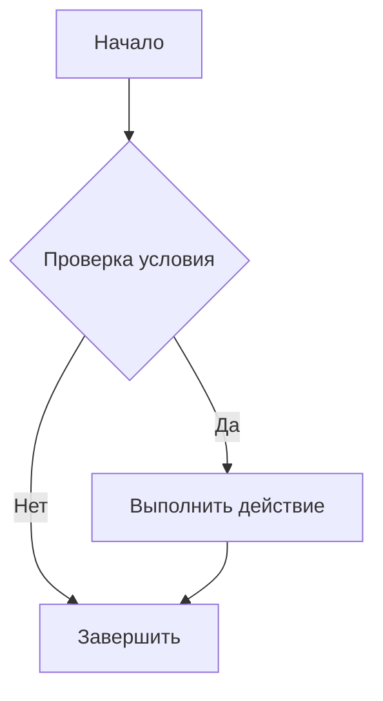
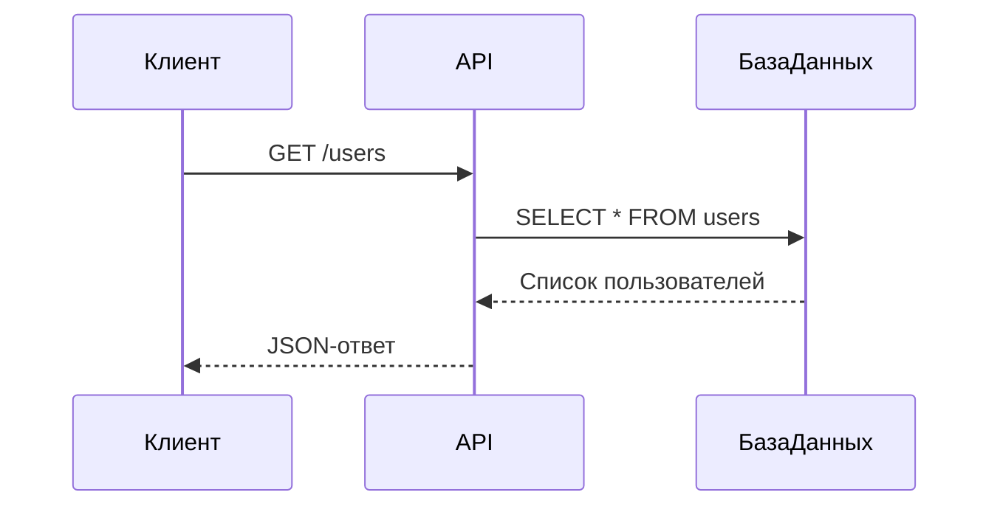

# Заголовок первого уровня

## Заголовок второго уровня

### Заголовок третьего уровня

#### Заголовок четвёртого уровня

##### Заголовок пятого уровня

###### Заголовок шестого уровня

Обычный абзац текста. Markdown поддерживает *курсив*, **жирный текст**, ***жирный курсив***, ~~зачёркнутый текст~~ и `встроенный код`.

---

## Текст и ссылки

Это [текстовая ссылка](https://example.com).

Это автоматическая ссылка: <https://example.com>.

Это ссылка с подсказкой: [Example](https://example.com "Подсказка при наведении").

Это ссылка на раздел документа: [Перейти к таблицам](#таблицы).


> Это цитата.
>
> Она может состоять из нескольких абзацев.
>
>> Это вложенная цитата.
>>
>>> Третий уровень вложенности цитаты.

---

## Списки

### Маркированный список

- Первый элемент
- Второй элемент
- Третий элемент
  - Вложенный элемент
  - Ещё один вложенный элемент
    - Элемент третьего уровня
- Последний элемент

### Нумерованный список

1. Первый шаг
2. Второй шаг
3. Третий шаг
   1. Подшаг 3.1
   2. Подшаг 3.2
4. Четвёртый шаг

### Список задач

- [x] Выполненная задача
- [x] Ещё одна выполненная задача
- [ ] Невыполненная задача
- [ ] Задача с `кодом`
- [ ] Задача с **выделенным текстом**

---

## Код

Встроенный Java-код: `System.out.println("Hello, Markdown!");`

### Блок кода без подсветки

```text
Обычный текст внутри блока кода.
    Сохраняются отступы.
```

### Java

```java
public class HelloMarkdown {
    public static void main(String[] args) {
        String message = "Привет, Markdown!";
        System.out.println(message);
    }
}
```

### SQL

```sql
SELECT id, name, email
FROM users
WHERE active = true
ORDER BY name ASC;
```

### JSON

```json
{
  "name": "Тестовый пользователь",
  "role": "Java Developer",
  "skills": ["Java", "Spring Boot", "PostgreSQL"],
  "active": true
}
```

### Bash

```bash
git status
git add .
git commit -m "Добавлен Markdown-документ"
git push origin main
```

---

## Таблицы

| Имя | Технология | Уровень | Активен |
|---|---|---:|:---:|
| Али | Java | Middle | ✅ |
| Мария | Python | Junior | ✅ |
| Ильяс | SQL | Senior | ❌ |

| Выравнивание слева | По центру | Справа |
|:---|:---:|---:|
| Текст | Текст | 100 |
| Java | Spring | 250 |
| SQL | PostgreSQL | 500 |

---

## Горизонтальные линии

Три варианта разделителя:

---

***

___

## Экранирование символов

\*Этот текст не станет курсивом\*

\**Этот текст не станет жирным\**

\# Это не заголовок

\[Это не ссылка\]

\`Это не встроенный код\`

---

## HTML внутри Markdown

<div align="center">

### Центрированный HTML-заголовок

<mark>Выделенный HTML-текст</mark>

<details>
  <summary>Нажмите, чтобы раскрыть скрытый текст</summary>

  Здесь находится скрытое содержимое.

  - Пункт списка
  - Ещё один пункт
</details>

</div>

<br>

<kbd>Ctrl</kbd> + <kbd>C</kbd> — копировать  
<kbd>Ctrl</kbd> + <kbd>V</kbd> — вставить

<sup>Верхний индекс</sup>  
<sub>Нижний индекс</sub>

H<sub>2</sub>O и E = mc<sup>2</sup>

---

## Сноски

Вот пример текста со сноской.[^1]

[^1]: Это текст сноски внизу документа.

---

## Определения

Термин
: Его определение в формате definition list.  
: Некоторые Markdown-редакторы поддерживают такой синтаксис.

---

## Математика

Встроенная формула: \( E = mc^2 \).

Блочная формула:

\[
\sum_{i=1}^{n} i = \frac{n(n+1)}{2}
\]

---

## Диаграмма Mermaid





---

## Emoji

🚀 Разработка  
✅ Готово  
⚠️ Внимание  
❌ Ошибка  
💡 Идея  
🔥 Важно  
🎓 Обучение  
☕ Java  

---

## Комментарий

<!-- Это HTML-комментарий. Обычно он не отображается в готовом документе. -->

## Смешанный пример

> **Совет:** используйте Markdown для документации проектов, README-файлов, конспектов и учебных материалов.
>
> Пример команды:
>
> ```bash
> mvn spring-boot:run
> ```
>
> Подробнее: [официальная документация Markdown](https://www.markdownguide.org/).
> 
